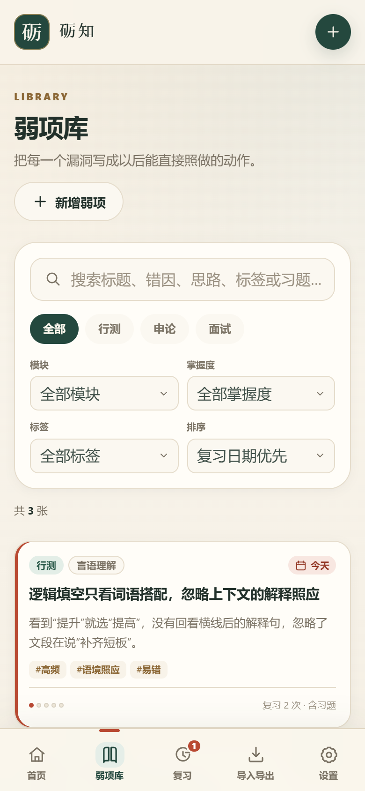
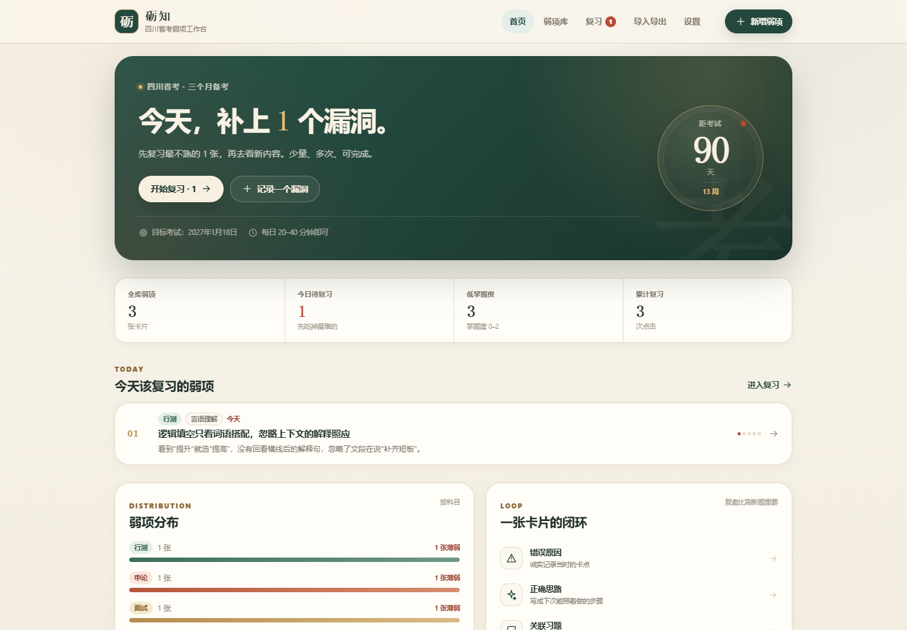
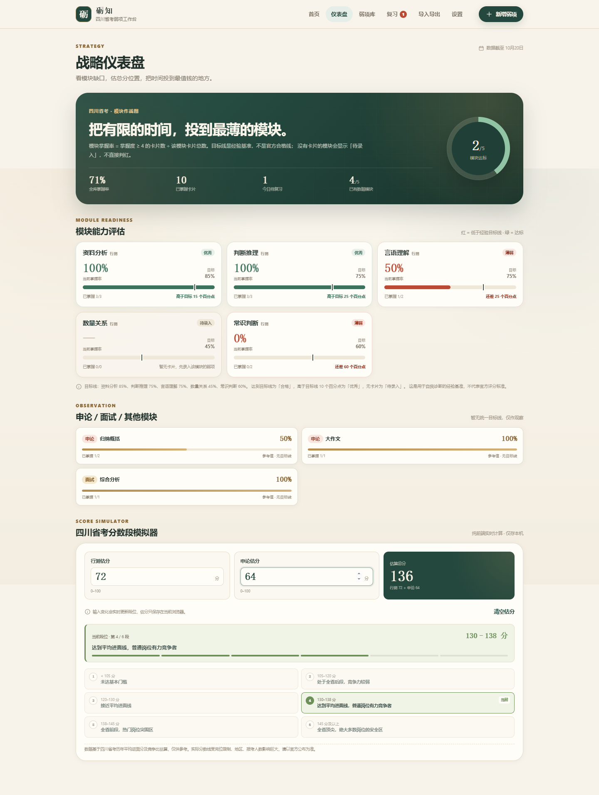
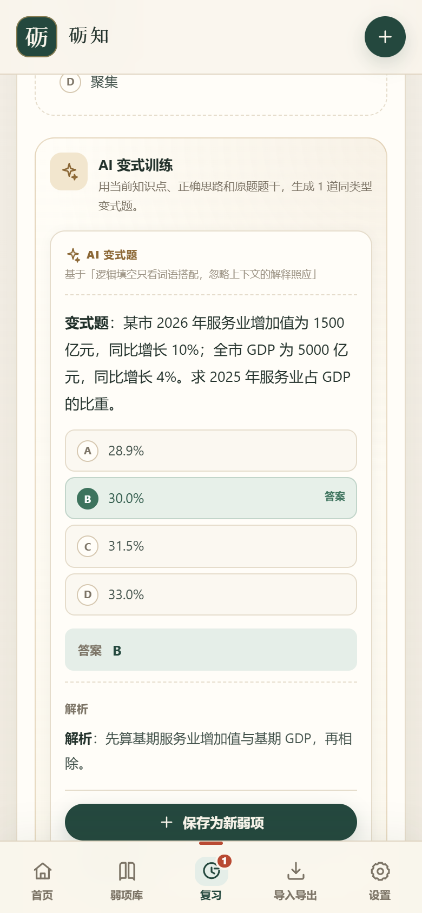

# 砺知 · 四川省考弱项工作台

一个**纯静态、无后端、无登录、无数据库**的考公弱项卡片 PWA。
把每个错点拆成「错误原因 → 正确思路 → 关联习题 → 复盘笔记」，再用简化版 SM-2 间隔复习反复回看。
可选接入任意 OpenAI 兼容的大模型接口，在复习时生成同类变式题。

- 手机 / 电脑浏览器均可使用
- 支持添加到主屏幕、离线打开
- 数据保存在浏览器 `localStorage`
- **战略仪表盘**：模块掌握率红绿灯 + 四川省考分数段模拟器
- 用 JSON 导出 / 合并导入 / 覆盖导入，手动同步手机与电脑
- 可选 AI 出题：API Key 只存本机，不写入导出的 JSON
- 已内置 GitHub Pages 自动部署工作流

> 线上地址由你自己的 GitHub Pages 提供，例如：`https://<你的用户名>.github.io/<仓库名>/`

## 界面预览

| 手机端 · 弱项库 | 桌面端 · 首页 |
| --- | --- |
|  |  |

> ⚠️ **API Key 安全提醒**：这是纯前端项目，Key 会保存在浏览器 `localStorage`，因此任何能操作这台设备或浏览器开发者工具的人都可能读到它。不要在公用电脑、公开演示环境使用主 Key；建议单独创建低额度、可随时撤销的 Key。接口请求直接由浏览器发往你填写的 Base URL。

---

## 目录

- [功能一览](#功能一览)
- [技术栈与取舍](#技术栈与取舍)
- [本地运行](#本地运行)
- [项目结构](#项目结构)
- [数据模型](#数据模型)
- [JSON 模板与示例](#json-模板与示例)
- [战略仪表盘](#战略仪表盘)
- [复习调度规则](#复习调度规则)
- [AI 出题接口](#ai-出题接口)
- [GitHub Pages 部署](#github-pages-部署)
- [手机添加到主屏幕](#手机添加到主屏幕)
- [验收自查](#验收自查)
- [数据安全与边界](#数据安全与边界)
- [常见问题](#常见问题)

---

## 功能一览

### 首页

- 「今天该复习的弱项」队列，按到期日期、掌握度排序
- 距四川省考倒计时，考试日期可在设置中修改（默认今天 + 90 天）
- 全库弱项、今日待复习、低掌握度、累计复习统计
- 科目分布、最需要补的模块
- 空库引导：新增、载入示例、JSON 批量导入

### 战略仪表盘

- 底部导航新增「仪表盘」
- 按科目 + 模块统计本地全部卡片
- 行测五个基准模块显示当前掌握率、目标线和红绿灯
- 掌握率 = `mastery >= 4` 的卡片数 / 该模块总卡片数
- 纯 CSS 进度条 + 目标刻度线 + 纯 CSS conic-gradient 达标环
- 申论 / 面试 / 自定义模块单独观察，不强行套用行测目标线
- 分数段模拟器：行测、申论实时求和，显示当前段位与全部段位阶梯
- 估分只存本机，可清空；不参与弱项导出
- 无 ECharts / Chart.js 等图表库

### 弱项库

- 新增 / 编辑 / 删除弱项
- 字段：科目、模块、知识点标题、错误原因、正确思路、关联习题、标签、掌握度、创建日期、下次复习日期、复习次数、复盘笔记
- 按科目、模块、标签、掌握度筛选
- 全字段搜索（标题 / 错因 / 思路 / 标签 / 习题 / 笔记）
- 排序：复习日期、掌握度、复习次数、创建时间
- 卡片详情展示完整复盘结构和习题答案解析

### 复习

- 到期卡片逐张复习，先回忆再揭示答案
- 关联习题：先看题干和选项，揭示后再看答案与解析
- 三档反馈：
  - 仍不会：掌握度 -1，明天再见
  - 模糊：掌握度不变，缩短间隔
  - 已掌握：掌握度 +1，拉长间隔
- 复习时可直接补写复盘笔记
- 完成后显示本轮统计和下一张到期日期

### AI 变式题（可选）

- 设置页填写 OpenAI 兼容接口的 Base URL、API Key、模型名，保存在本机
- 复习页「关联习题」下方出现「AI 生成同类题」按钮
- 前端组装「科目 / 模块 / 知识点标题 / 正确思路 / 原题题干」作为 Prompt
- 调用 `POST {Base URL}/chat/completions`，非流式返回 1 道变式题
- 题干、选项、解析用 `react-markdown` + GFM 渲染
- 生成结果可一键「保存为新弱项」：掌握度 0、明天到期、自动打上 `AI变式` 标签
- 完整 loading 状态、取消、超时、HTTP 错误、CORS / 网络错误提示

### 导入 / 导出

- 一键下载完整 JSON 备份
- 复制 JSON 到剪贴板
- 粘贴 JSON 数组批量导入
- 上传 `.json` 文件导入
- 合并导入：保留现有卡片，同 ID 以更新时间较新的版本为准
- 覆盖导入：清空当前卡片，完整恢复备份（有二次确认）
- 内置标准模板和 3 张可导入示例卡片
- 完整示例文件：[docs/sample-cards.json](docs/sample-cards.json)

### PWA

- `manifest.webmanifest` + 192 / 512 / maskable 图标
- Service Worker 预缓存首屏 HTML、Vite 构建产物、图标
- 首次联网打开后，断网刷新仍可查看与操作
- 有安装条件时显示「安装砺知到主屏幕」；否则给出 iOS / Android / 桌面手动步骤
- 顶部与设置页显示在线 / 离线状态

### 设计参考

- **GongkaoNaoku**：借鉴其「掌握度 + 复习次数」的简化 SM-2 思路
- **Octopus Kaogong PWA**：移动端底部五栏导航、卡片列表、筛选和搜索
- **kaogong-skill**：错误原因 → 正确思路 → 关联习题 → 复盘笔记的复盘闭环

AI 功能是**可选、按次触发**的：只有你点击「AI 生成同类题」时，页面才会向你配置的接口发送当前弱项的上下文；不会在后台自动请求，也不会把数据发送到其他地址。

---

## 技术栈与取舍

- **React 19 + Vite 6 + TypeScript**
- **普通 CSS**（约 78 KB），不依赖 Tailwind，构建更轻、样式更可控
- **react-markdown + remark-gfm**：安全渲染 AI 返回的 Markdown，不启用原始 HTML
- 无 React Router：使用轻量 hash 路由（`#/home`、`#/library`…），GitHub Pages 刷新不会 404
- 无状态管理库：一个 `StoreProvider` + `localStorage` 持久化
- 无 PWA 插件：手写 `public/sw.js`，安装时解析 `index.html` 预缓存带 hash 的 JS/CSS
- `vite.config.ts` 使用 `base: './'`，同一份 `dist` 可部署在 GitHub Pages 项目子路径，也可部署到自定义域名根路径

构建体积约 **502 KB JS / 78 KB CSS**（gzip 后约 156 KB / 14 KB）。
新增仪表盘只增加了少量 HTML/CSS 逻辑，没有引入任何图表库；Markdown 解析器仍是体积主要增量。

---

## 本地运行

要求 Node.js 20+。

```bash
cd kaogong-weakness-pwa
npm install
npm run dev
```

打开终端提示的地址（默认 `http://localhost:5173/`）。

生产构建与本地预览：

```bash
npm run build
npm run preview
```

类型检查：

```bash
npm run typecheck
```

> Service Worker 只在**生产构建**中注册，且浏览器要求 `localhost` 或 HTTPS。
> `npm run preview` 在 `localhost` 下也会注册 Service Worker，可以用来验证离线；真实手机安装请部署到 GitHub Pages（HTTPS）。

---

## 项目结构

```text
kaogong-weakness-pwa/
├─ .github/
│  └─ workflows/
│     └─ deploy.yml              # GitHub Pages 自动构建部署
├─ docs/
│  ├─ preview-mobile.png         # README 手机端预览
│  ├─ preview-desktop.png        # README 桌面端预览
│  ├─ preview-ai.png             # AI 变式题预览
│  ├─ preview-dashboard.png      # 战略仪表盘预览
│  └─ sample-cards.json          # 可直接批量导入的 3 张示例
├─ public/
│  ├─ icons/
│  │  ├─ favicon.svg
│  │  ├─ icon-192.png
│  │  ├─ icon-512.png
│  │  ├─ icon-maskable-512.png
│  │  └─ apple-touch-icon.png
│  ├─ manifest.webmanifest       # PWA 清单
│  ├─ sw.js                      # Service Worker：预缓存 + 离线回退
│  ├─ robots.txt
│  └─ .nojekyll                  # 防止 GitHub Pages 的 Jekyll 处理
├─ src/
│  ├─ components/
│  │  ├─ BottomNav.tsx           # 移动端底部导航
│  │  ├─ TopBar.tsx              # 顶部品牌 / 桌面导航
│  │  ├─ CardItem.tsx
│  │  ├─ CardDetailModal.tsx
│  │  ├─ CardEditorModal.tsx     # 新增 / 编辑表单
│  │  ├─ ConfirmDialog.tsx
│  │  ├─ EmptyState.tsx
│  │  ├─ Icon.tsx
│  │  ├─ MasteryDots.tsx
│  │  ├─ Modal.tsx
│  │  ├─ SubjectBadge.tsx
│  │  └─ Toast.tsx
│  ├─ data/
│  │  └─ constants.ts            # 科目、模块、掌握度、标签建议
│  ├─ hooks/
│  │  ├─ usePwa.ts               # 安装提示、在线状态
│  │  └─ useAiConfig.ts          # AI 配置读写与跨页面同步
│  ├─ lib/
│  │  ├─ date.ts                 # 本地日期计算，避免时区偏移
│  │  ├─ model.ts                # 数据规范化、表单草稿
│  │  ├─ srs.ts                  # 简化 SM-2 复习调度
│  │  ├─ storage.ts              # localStorage 读写
│  │  ├─ importExport.ts         # JSON 解析、合并 / 覆盖、模板
│  │  ├─ strategy.ts             # 模块目标线、掌握率、分数段、估分存储
│  │  ├─ ai.ts                   # OpenAI 兼容接口、Prompt、解析、错误处理
│  │  ├─ id.ts
│  │  └─ cx.ts
│  ├─ pages/
│  │  ├─ HomePage.tsx
│  │  ├─ DashboardPage.tsx       # 战略仪表盘 / 模块评估 / 分数模拟器
│  │  ├─ LibraryPage.tsx
│  │  ├─ ReviewPage.tsx
│  │  ├─ ImportExportPage.tsx
│  │  └─ SettingsPage.tsx
│  ├─ App.tsx                    # hash 路由、弹窗、Toast
│  ├─ store.tsx                  # 全局数据与操作
│  ├─ types.ts
│  ├─ styles.css
│  ├─ main.tsx
│  └─ vite-env.d.ts
├─ index.html
├─ package.json
├─ package-lock.json
├─ tsconfig.json
├─ tsconfig.app.json
├─ tsconfig.node.json
├─ vite.config.ts
└─ README.md
```

### 关键代码入口

| 想改什么 | 文件 |
| --- | --- |
| 复习间隔公式 | [`src/lib/srs.ts`](src/lib/srs.ts) |
| 导入字段兼容 / 合并覆盖 | [`src/lib/importExport.ts`](src/lib/importExport.ts) |
| 模块目标线 / 掌握率 / 分数段 | [`src/lib/strategy.ts`](src/lib/strategy.ts) |
| 战略仪表盘页面 | [`src/pages/DashboardPage.tsx`](src/pages/DashboardPage.tsx) |
| AI 接口 / Prompt / 解析 | [`src/lib/ai.ts`](src/lib/ai.ts) |
| AI 配置读写 | [`src/hooks/useAiConfig.ts`](src/hooks/useAiConfig.ts) |
| 本地存储 | [`src/lib/storage.ts`](src/lib/storage.ts) |
| 新增 / 编辑表单 | [`src/components/CardEditorModal.tsx`](src/components/CardEditorModal.tsx) |
| 复习交互 / AI 出题 UI | [`src/pages/ReviewPage.tsx`](src/pages/ReviewPage.tsx) |
| AI 接口设置 | [`src/pages/SettingsPage.tsx`](src/pages/SettingsPage.tsx) |
| 主题色 / 响应式 | [`src/styles.css`](src/styles.css)（顶部 `:root`） |
| 离线缓存 | [`public/sw.js`](public/sw.js) |
| PWA 清单 | [`public/manifest.webmanifest`](public/manifest.webmanifest) |

---

## 数据模型

一张弱项卡片的 TypeScript 类型：

```ts
interface WeaknessCard {
  id: string
  subject: '行测' | '申论' | '面试'
  module: string
  title: string
  errorReason: string          // 我的错误原因
  correctApproach: string      // 正确思路
  exercise: {
    stem: string
    options: string[]
    answer: string
    explanation: string
  } | null                     // 关联习题，可为空
  tags: string[]
  mastery: 0 | 1 | 2 | 3 | 4 | 5
  createdAt: string            // ISO 时间戳
  nextReviewAt: string         // 本地日期 YYYY-MM-DD
  reviewCount: number
  lastReviewedAt: string | null
  reviewNote: string           // 复盘笔记
  updatedAt: string            // ISO 时间戳，合并时用于判断新旧
}
```

本地存储键：`lizhi.kaogong.weakness.v1`

完整导出文件结构：

```json
{
  "app": "lizhi-kaogong-weakness",
  "schemaVersion": 1,
  "exportedAt": "2026-10-20T10:00:00.000Z",
  "cards": [],
  "settings": {
    "examDate": "2027-01-18",
    "lastImportAt": "2026-10-20T10:00:00.000Z"
  }
}
```

导入时同时接受：

1. 顶层 JSON 数组（批量导入）
2. 本应用导出的完整对象（含 `cards`）
3. 中文键名别名，如「科目」「模块」「知识点标题」「错误原因」「正确思路」「关联习题」「标签」「掌握度」「下次复习日期」「复盘笔记」

除 `subject`、`title` 外都可以省略，系统会自动补默认值。

---

## JSON 模板与示例

### 标准模板

```json
[
  {
    "subject": "行测",
    "module": "资料分析",
    "title": "基期比重计算把现期当基期",
    "errorReason": "看到“比重”就直接用了现期数据，忘了基期是上一期。",
    "correctApproach": "先圈时间词，写公式：基期比重 = 现期比重 × (1 + 整体增长率) / (1 + 部分增长率)，再代入。",
    "exercise": {
      "stem": "2025 年某市第三产业增加值为 1200 亿元，同比增长 8%；全市 GDP 为 3000 亿元，同比增长 5%。求 2024 年第三产业占 GDP 的比重。",
      "options": ["A. 38.6%", "B. 40.0%", "C. 41.2%", "D. 42.0%"],
      "answer": "A",
      "explanation": "先求基期值再相除，不能直接用现期比重。"
    },
    "tags": ["高频", "计算", "易错"],
    "mastery": 1,
    "createdAt": "2026-10-20T09:00:00.000Z",
    "nextReviewAt": "2026-10-20",
    "reviewCount": 0,
    "lastReviewedAt": null,
    "reviewNote": ""
  }
]
```

### 最小示例（只有必填字段）

```json
[
  {
    "subject": "申论",
    "title": "归纳概括要点合并过度，漏掉并列采分点",
    "module": "归纳概括",
    "errorReason": "把资金、人才、技术三类问题合成一句“要素保障不足”。",
    "correctApproach": "先逐段列点，再合并同类项，保留不同维度的关键词。",
    "mastery": 2,
    "nextReviewAt": "2026-10-22"
  },
  {
    "subject": "面试",
    "title": "综合分析只谈危害，缺少原因与对策",
    "errorReason": "原因分析只有一句“监管不到位”。",
    "correctApproach": "用“表态—影响—原因—对策—升华”结构，每个原因跟一条措施。",
    "tags": ["结构化面试", "答题结构"],
    "mastery": 1
  }
]
```

### 完整可导入示例

直接复制 [`docs/sample-cards.json`](docs/sample-cards.json) 到应用的「导入导出 → JSON 内容」文本框，选择「合并导入」即可。

也可以在应用内点击「填入示例 JSON」，会按当天日期生成 3 张示例卡片（1 张今天到期）。

### 字段说明

| 字段 | 必填 | 说明 |
| --- | --- | --- |
| `subject` | 是 | 只能是 `行测`、`申论`、`面试` |
| `title` | 是 | 知识点标题 |
| `module` | 否 | 自定义模块，默认「未分类」 |
| `errorReason` | 否 | 我的错误原因 |
| `correctApproach` | 否 | 正确思路 / 可复用步骤 |
| `exercise` | 否 | `null` 或 `{ stem, options, answer, explanation }` |
| `tags` | 否 | 字符串数组；也接受逗号分隔字符串 |
| `mastery` | 否 | 0–5 整数，默认 0 |
| `createdAt` | 否 | ISO 时间或可解析日期，默认当前时间 |
| `nextReviewAt` | 否 | `YYYY-MM-DD`；省略时按掌握度计算首次复习日 |
| `reviewCount` | 否 | 非负整数，默认 0 |
| `lastReviewedAt` | 否 | ISO 时间或 `null` |
| `reviewNote` | 否 | 复盘笔记 |
| `updatedAt` | 否 | 合并时判断新旧；省略时用 `createdAt` |

### 导入规则

- **合并导入**
  - 按 `id` 匹配；新 ID 直接追加
  - 同 ID 时，`updatedAt` 较新的版本替换旧版本，较旧的跳过
  - 不会删除当前设备已有卡片
  - 文件带了设置时，考试日期以文件为准
- **覆盖导入**
  - 卡片列表完整替换为文件内容
  - 文件带 `settings` 时，考试日期一并恢复
  - 本机已有卡片时会先弹二次确认
- 导入完成后会显示「新增 / 更新 / 跳过」数量

手机与电脑同步建议：

1. 旧设备「下载 JSON 备份」
2. 通过微信 / QQ / 网盘 / AirDrop 传到新设备
3. 新设备选择「覆盖导入」（完整恢复）或「合并导入」（保留新设备新增内容）

---

## 战略仪表盘

底部导航新增 **仪表盘**（`#/dashboard`），集中展示模块缺口和分数段模拟。



### 模块能力评估

统计本地库全部卡片的 `subject` 和 `module`：

```text
模块当前掌握率 = 该模块 mastery >= 4 的卡片数 / 该模块卡片总数
```

行测五个基准模块使用硬编码目标线：

| 模块 | 目标掌握率 |
| --- | --- |
| 资料分析 | 85% |
| 判断推理 | 75% |
| 言语理解 | 75% |
| 数量关系 | 45% |
| 常识判断 | 60% |

状态规则：

- **薄弱**：当前掌握率 < 目标值，进度条和状态标红，并显示还差多少个百分点
- **合格**：当前掌握率 >= 目标值
- **优秀**：当前掌握率 >= 目标值 + 10 个百分点
- **待录入**：该模块还没有卡片，显示为中性灰，不强行判红

模块名做了简单别名兼容，例如「资料」「资料分析」「判断」「言语」「数量」「常识」都能归入对应基准模块；匹配时优先精确匹配，避免把「常识判断」误归到「判断推理」。

申论、面试以及自定义行测模块会进入「申论 / 面试 / 其他模块」区域，只展示参考掌握率，不套用行测目标线，也不参与五模块达标环。

界面实现：

- 纯 CSS 进度条 + 目标刻度线
- 纯 CSS `conic-gradient` 达标环
- 无 ECharts、Chart.js 或任何图表依赖
- 目标线是可解释的经验自测基准，不是官方评分标准

### 分数段模拟器

输入行测、申论两个 0–100 的估分，页面实时计算：

```text
估算总分 = 行测估分 + 申论估分
```

分数段边界采用「含下限、不含上限」：

| 总分 | 段位说明 |
| --- | --- |
| `< 105` | 未达基本门槛 |
| `105 <= 总分 < 120` | 处于全省后段，竞争力较弱 |
| `120 <= 总分 < 130` | 接近平均进面线 |
| `130 <= 总分 < 138` | 达到平均进面线，普通岗位有力竞争者 |
| `138 <= 总分 < 145` | 全省前段，热门岗位突围区 |
| `>= 145` | 全省顶尖，绝大多数岗位的安全区 |

- 支持整数和小数估分，输入即更新
- 超出 0–100 会显示错误提示，总分暂停计算
- 估分存入本机 `lizhi.kaogong.scores.v1`，刷新后仍保留
- 估分不进入弱项 JSON 导出，也不上传服务器
- 可随时点「清空估分」
- 页面底部固定免责声明：

> 数据基于四川省考历年平均进面分及竞争比估算，仅供参考。实际分数线受岗位限制、地区、报考人数影响巨大，请以官方公布为准。

### 性能

仪表盘没有新增任何运行时依赖，也没有引入图表库。新增部分主要是 HTML、CSS 和几十行纯计算逻辑，不会额外阻塞首屏。

---

## 复习调度规则

实现位于 [`src/lib/srs.ts`](src/lib/srs.ts)，只使用「掌握度 + 复习次数」两个变量，便于理解和手动修正。

### 首次复习间隔

| 掌握度 | 0 | 1 | 2 | 3 | 4 | 5 |
| --- | --- | --- | --- | --- | --- | --- |
| 首次间隔（天） | 0 | 0 | 1 | 2 | 4 | 7 |

所以新建一张掌握度 0–1 的卡片，当天就会出现在首页「今天该复习的弱项」里。

### 到期后三档反馈

基础间隔由掌握度决定：

```text
掌握度:      0  1  2  3   4   5
基础间隔:    1  2  4  7  14  30  天
最长间隔:    3  7 15 30  60 120 天
```

- **仍不会**
  - 掌握度 -1（最低 0）
  - 下次间隔固定 1 天
  - 复习次数 +1
- **模糊**
  - 掌握度不变
  - 间隔 = 基础间隔 × 1.35^复习次数，受最长间隔限制
- **已掌握**
  - 掌握度 +1（最高 5）
  - 间隔 = 基础间隔 × 1.6^复习次数，受最长间隔限制

核心公式：

```ts
const base = BASE_INTERVAL_BY_MASTERY[mastery] // [1, 2, 4, 7, 14, 30]
const multiplier = grade === 'good' ? 1.6 ** reps : 1.35 ** reps
const cap = MAX_INTERVAL_BY_MASTERY[mastery] // [3, 7, 15, 30, 60, 120]
const days = Math.max(1, Math.min(cap, Math.round(base * multiplier)))
```

日期统一按**本地日期**计算，避免 UTC 导致跨天。复习次数每反馈一次 +1。

这不是严格完整的 SM-2（没有单独的 ease factor 字段），但保留了「答得好拉长、答得差缩短」的核心行为，且每个数字都能在界面上解释。

---

## AI 出题接口

这是可选功能。不配置时，应用完全离线可用，不会发起任何 AI 请求。



### 1. 配置

进入 **设置 → AI 出题接口**：

| 配置项 | 默认值 | 说明 |
| --- | --- | --- |
| API Base URL | `https://api.deepseek.com` | OpenAI 兼容接口根地址；会自动补 `/chat/completions` |
| 模型名称 | `deepseek-flash` | 以服务商控制台的模型名为准；旧接口也常用 `deepseek-chat` |
| API Key | 空 | 只保存在当前浏览器 |

DeepSeek 接口文档：[https://api-docs.deepseek.com/](https://api-docs.deepseek.com/)。

也可以直接填写完整地址，例如 `https://api.deepseek.com/chat/completions`，程序会识别并原样使用。

配置保存在独立的 localStorage 键：

```text
lizhi.kaogong.ai.v1
```

它**不会**写入「导入导出」的弱项 JSON；换设备时需要在每台设备上重新填写 API Key。

### 2. 请求格式

```http
POST {Base URL}/chat/completions
Authorization: Bearer {API Key}
Content-Type: application/json
```

请求体是标准 OpenAI Chat Completions：

```json
{
  "model": "deepseek-flash",
  "messages": [
    { "role": "system", "content": "你是四川省考命题老师…" },
    { "role": "user", "content": "科目 / 模块 / 知识点 / 正确思路 / 原题题干…" }
  ],
  "temperature": 0.8,
  "max_tokens": 1600,
  "stream": false
}
```

前端 Prompt 会带上当前卡片的：

- 科目、模块
- 知识点标题
- 正确思路
- 原题题干（没有关联习题时会注明「自主命题」）

### 3. 模型返回

Prompt 要求模型只返回 1 个 JSON 对象：

```json
{
  "stem": "变式题题干，可以包含 Markdown",
  "options": ["选项 A 内容", "选项 B 内容", "选项 C 内容", "选项 D 内容"],
  "answer": "B",
  "explanation": "详细解析，可以包含 Markdown"
}
```

解析器做了容错：

- 允许模型在 JSON 外包一层 ```json 代码围栏
- 允许前后有少量说明文字，会提取第一个完整 JSON 对象
- 兼容 `question` / `choices` / `correctAnswer` / `analysis` 等字段名
- 去掉选项自带的 A/B/C/D 前缀，统一由前端编号
- 答案可能是选项原文，会自动映射回字母

题干、选项、解析都用 `react-markdown` + `remark-gfm` 渲染。没有启用原始 HTML，默认会清理不安全的链接协议；Markdown 图片也被禁用，避免模型输出触发外部资源请求。

### 4. 保存为新弱项

点击变式题下方的「保存为新弱项」后，会创建一张卡片：

- 科目 / 模块：沿用原卡
- 标题：`AI变式：{原知识点标题}`
- 错误原因：注明这是 AI 生成的同类变式题
- 正确思路：沿用原卡
- 关联习题：生成的题干、选项、答案、解析
- 标签：原标签 + `AI变式`
- 掌握度：`0`
- 下次复习：**明天**
- 复盘笔记：记录来源知识点

保存后按钮变为「已保存为新弱项」，不会重复入库。

### 5. 安全与 CORS

- **API Key 会暴露给浏览器**：这是纯前端直连的固有代价。任何能打开开发者工具或读取本机存储的人都能拿到 Key。
- 建议单独创建一把**低额度、可随时撤销**的 Key；不要用主账号 Key。
- 不要在公用电脑或公开演示环境中保存 Key。
- Key 不会发送到 `Base URL` 以外的地址，也不会跟随弱项 JSON 导出。
- 请求直接从浏览器发出，受同源策略约束：
  - DeepSeek 官方 API 当前支持浏览器 CORS（预检允许 `Authorization` 和 `Content-Type`）。
  - 其他 OpenAI 兼容服务可能不允许浏览器跨域；若控制台提示 CORS，需要换用支持 CORS 的接口或填写你自己的代理地址。
  - 如果希望 Key 完全不进入浏览器，需要自建一个在服务端保存 Key 的代理；本项目不内置该后端。
- 每次生成都会消耗对应平台的 API 额度；费用由你的 API 账户承担。

### 6. 错误处理

生成区会显示具体状态：

- 加载中：「AI 正在出题…」，可点击「取消」
- 未配置：按钮禁用，并给出去设置入口
- 401：API Key 无效或过期
- 402：账户余额不足
- 403：模型权限不足
- 404：Base URL 路径或模型名错误
- 429：请求过于频繁或额度受限
- 超时：60 秒后中止
- 网络 / CORS：提示检查网络、Base URL 和跨域设置
- 返回内容不是合法 JSON：提示模型未按要求返回，可重试

请求超时、取消、组件卸载都会中止 fetch，避免把结果写回已经不存在的卡片。

---

## GitHub Pages 部署

项目已包含 [`.github/workflows/deploy.yml`](.github/workflows/deploy.yml)。

### 1. 推到 GitHub

在项目目录执行：

```bash
git init
git add .
git commit -m "feat: 砺知考公弱项工作台 PWA"
git branch -M main
git remote add origin https://github.com/<你的用户名>/<仓库名>.git
git push -u origin main
```

### 2. 打开 Pages

进入 GitHub 仓库：

**Settings → Pages → Build and deployment → Source**

选择 **GitHub Actions**（不要选 “Deploy from a branch”）。

### 3. 等待工作流

打开仓库的 **Actions** 标签，等待 `Deploy to GitHub Pages` 变绿。
成功后地址通常是：

```text
https://<你的用户名>.github.io/<仓库名>/
```

如果仓库名是 `<你的用户名>.github.io`，地址就是：

```text
https://<你的用户名>.github.io/
```

### 4. 更新版本

之后每次 `git push` 到 `main`，工作流会自动重新构建部署。

浏览器会更新 Service Worker；如果主屏幕应用仍显示旧内容：

1. 关闭应用后重新打开
2. 或在浏览器里刷新两次
3. 重要更新时，把 [`public/sw.js`](public/sw.js) 顶部的 `VERSION` 从 `v1.2.0` 改成 `v1.2.1`，强制清理旧缓存

### 为什么不需要改 `base`

`vite.config.ts` 已设为：

```ts
base: './'
```

所有资源使用相对路径，因此项目页子路径和自定义域名根路径都能工作。
不要改成 `/`，否则部署到 `https://user.github.io/repo/` 时会找不到资源。

### 可选：自定义域名

1. 在仓库 Pages 设置里绑定域名
2. 在 `public/` 放 `CNAME` 文件（内容为域名）
3. 重新 push
4. 确保 HTTPS 生效后再安装 PWA

---

## 手机添加到主屏幕

安装要求：**HTTPS**（GitHub Pages 默认提供）且页面至少联网成功打开过一次，让 Service Worker 完成缓存。

### iPhone / iPad（Safari）

1. 用 **Safari** 打开你的 GitHub Pages 地址
2. 点底部工具栏的「分享」按钮（方框向上箭头）
3. 下滑选择「添加到主屏幕」
4. 名称可保持「砺知」，点右上角「添加」
5. 从主屏幕图标打开，即为独立窗口

> iOS 上只有 Safari 可以添加到主屏幕；Chrome / 微信内置浏览器不行。
> 不同浏览器或安装方式可能使用不同的本地存储空间，换设备/换浏览器请用 JSON 导入导出迁移。

### Android（Chrome / Edge）

1. 用 Chrome 或 Edge 打开地址
2. 点右上角「⋮」菜单
3. 选择「安装应用」或「添加到主屏幕」
4. 确认安装
5. 从桌面图标打开

部分浏览器会在页面底部自动弹出安装提示；如果没弹，按上面步骤手动添加。
应用内「设置 → 添加到主屏幕」也会在浏览器支持时显示安装按钮。

### 电脑（Chrome / Edge）

1. 打开地址
2. 点地址栏右侧的安装图标（显示器 + 下箭头）
3. 或打开浏览器菜单 →「安装砺知」
4. 安装后从桌面 / 开始菜单打开

### 安装后

- 全屏独立窗口，没有浏览器地址栏
- 断网可打开已缓存页面并继续查看 / 编辑本机数据
- 数据仍存在浏览器 `localStorage`，卸载 / 清理站点数据会删除
- 手机电脑之间没有自动云同步，请用「导入导出」的 JSON 手动同步

---

## 验收自查

以下项目已在 Edge + Playwright 环境实际跑过：

| 验收标准 | 结果 |
| --- | --- |
| 手机 / 电脑打开不横向滚动 | 360px / 390px / 768–901px / 1440px 下六个页面均无横向溢出 |
| 能新增一条弱项并关联一道习题 | 通过；字段写入 localStorage，详情可查看答案解析 |
| 首页能看到今天该复习的卡片 | 通过；低掌握度新卡当天到期，首页显示与角标同步 |
| 导出 JSON 并在另一台设备导入后数据一致 | 通过；覆盖导入后 cards JSON 完全一致 |
| 断网后已加载页面仍可查看 | 通过；首次联网打开后断网刷新仍可打开 |
| 批量导入 JSON 数组 | 通过；3 张示例一次导入 |
| PWA 清单与 Service Worker | 通过；manifest 含 3 个图标，SW 正常控制页面 |
| 仪表盘：六栏底部导航与页面路由 | 通过；`#/dashboard` 正常打开，360px 不横向溢出 |
| 仪表盘：模块掌握率与红绿灯 | 通过；使用已知 mastery 卡片验证 100% / 50% / 0% / 待录入和差值 |
| 仪表盘：分数段边界 | 通过；104 / 105 / 120 / 130 / 138 / 145 / 小数估分全部命中对应段位 |
| 仪表盘：估分持久化与免责声明 | 通过；刷新保留估分，免责声明逐字匹配 |
| AI 配置本地保存 / 刷新保留 / 可清除 | 通过；Key 以密码框展示，存储于独立键 |
| AI 生成 loading / Markdown 展示 | 通过；用本地 mock 接口验证请求、loading 与渲染 |
| 保存 AI 变式题 | 通过；新卡掌握度 0、次日到期、带 `AI变式` 标签 |
| AI 错误处理 | 通过；401 与网络 / CORS 错误均有明确提示 |
| API Key 不进入 JSON 导出 | 通过；导出文件不包含 Key 或 Base URL |

手动验收建议：

1. 新增一张掌握度 1 的弱项，关联一道选择题
2. 回首页确认「今天该复习的弱项」出现
3. 进复习页，先看题，再揭示答案，选「已掌握」
4. 回首页确认卡片从今日队列消失
5. 到「导入导出」下载 JSON
6. 用另一台设备 / 另一个浏览器打开，选择「覆盖导入」，导入同一个文件
7. 对比弱项库内容和复习进度
8. 在 HTTPS 环境断网刷新，确认页面仍能打开
9. 打开「仪表盘」，检查资料分析等模块的掌握率、目标刻度和红绿灯
10. 填入一组行测 / 申论估分，验证总分与段位实时变化；刷新后确认估分保留
11. 在设置里配置一个测试用 AI 接口，复习页点击「AI 生成同类题」，确认 loading、Markdown、保存新弱项
12. 换一个错误 Key 或断网，确认错误提示可读且页面不崩溃

> AI 功能测试使用 Playwright 路由 mock，没有在验收中消耗真实 API 额度。

---

## 数据安全与边界

- **没有后端，没有登录，没有数据库，没有云同步。**
- 默认不发起 AI 请求，页面只加载自身静态资源。
- 只有点击「AI 生成同类题」时，才会向你配置的 Base URL 发送当前卡片的科目、模块、知识点标题、正确思路和原题题干；不会发送整库数据、复盘笔记或 API Key 以外的无关信息。
- **API Key 存储在当前浏览器，前端无法真正隐藏它。** 请使用低额度、可撤销的 Key；详见 [AI 出题接口](#ai-出题接口)。
- 弱项数据保存在 `localStorage` 的 `lizhi.kaogong.weakness.v1`；AI 配置单独保存在 `lizhi.kaogong.ai.v1`；分数模拟器估分保存在 `lizhi.kaogong.scores.v1`。
- 仪表盘完全在本地计算，不调用任何新接口，也不上传估分。
- 弱项 JSON 导出不包含 AI Key、Base URL、模型配置或模拟器估分；换设备需要重新填写 AI 配置和估分。
- 清理浏览器站点数据、使用无痕模式、卸载浏览器或换设备，都会导致弱项数据和 AI 配置不可用；请定期导出 JSON。
- 手机和电脑之间没有自动同步；JSON 文件就是你的「同步协议」。
- Service Worker 只缓存同源 GET 静态资源，不缓存 AI 的 POST 请求。
- 如果浏览器禁用 `localStorage` 或空间不足，页面顶部会出现保存失败提示；请先导出备份。

---

## 常见问题

### 为什么新卡一创建就出现在「今天该复习」？

掌握度 0–1 的首次间隔是 0 天，设计上希望当天就完成第一次主动回忆。若不想当天复习，可以在表单里把「下次复习日期」改到未来。

### 为什么我选了「已掌握」，下次却是几天后而不是立刻？

「已掌握」会提高掌握度并拉长间隔；具体天数由基础间隔 × 1.6^复习次数计算，并在弹窗按钮上实时显示。可以在卡片编辑里手动改日期。

### 为什么没有自动同步？

这是刻意的取舍：不引入账号和后端，避免隐私与部署复杂度。用 JSON 手动同步在几十到几百张卡片的规模下完全够用；合并导入会按 `updatedAt` 处理冲突。

### 导入后重复了怎么办？

同一 ID 的卡片按更新时间去重；如果你手动改了 `id` 或没有 ID，会被视为新卡片。批量导入前建议先用「覆盖导入」或检查 JSON 中的 `id`。

### 为什么安装按钮不出现？

- 必须 HTTPS 或 localhost
- Safari / Firefox 可能不触发自动安装，需要手动「添加到主屏幕」
- 页面需至少成功联网加载一次
- 某些浏览器要求先与页面交互
- 若仍没有，使用「设置」页的手动步骤即可

### 更新部署后主屏幕还是旧版？

关闭重开，或刷新两次；Service Worker 采用网络优先的页面导航，通常会自动拿到新版本。必要时提高 `public/sw.js` 的 `VERSION`，让旧缓存被清理。

### 可以改成其他考试 / 其他科目吗？

可以。修改 [`src/data/constants.ts`](src/data/constants.ts) 中的科目与模块，结合 [`src/types.ts`](src/types.ts) 的 `Subject` 类型；首页倒计时在设置页修改考试日期，不需要改代码。

### 为什么某个模块显示「待录入」，而不是红色薄弱？

「待录入」表示该模块卡片数为 0，掌握率没有分母。直接标红会制造虚假的薄弱信号，所以用中性灰提示你先录卡片。录入后就会按 `mastery >= 4` 的比例计算。

### 仪表盘的目标线和分数段是官方数据吗？

不是。模块目标线是用于自我诊断的经验基准；分数段基于历年平均进面分和竞争比估算。实际分数线受岗位、地区、报考人数影响巨大，请以官方公布为准。页面底部已固定免责声明。

### 估分会跟着 JSON 备份走吗？

不会。估分保存在独立的 `lizhi.kaogong.scores.v1`，不进入弱项 JSON。它只是模拟器输入，换设备或清理站点数据后需要重新填写。

### AI 生成失败怎么办？

按提示排查：

1. **401 / 403**：检查 API Key 是否复制完整、是否有该模型权限。
2. **404**：检查 Base URL 是否少了 `/v1`，或模型名是否写错。
3. **CORS / 无法连接**：浏览器控制台若提示 CORS，说明该接口不允许网页跨域；换用支持 CORS 的接口，或填写自己的代理地址。DeepSeek 官方接口当前支持 CORS。
4. **返回 JSON 解析失败**：模型没有按格式返回，点「重新生成」或换一个指令遵循能力更好的模型。
5. **超时**：默认 60 秒；高峰期可稍后重试或换更快模型。

### API Key 会被导出或同步到另一台设备吗？

不会。AI 配置使用独立的 localStorage 键，不进入弱项 JSON。这是为了避免备份文件泄露 Key。换设备后请在设置里重新填写。

### AI 会自动帮我改复盘笔记吗？

不会。当前只做「根据知识点、正确思路和原题生成 1 道变式题」，不会自动改写弱项、笔记或掌握度。所有卡片内容仍由你确认后保存。

---

## 默认品牌与自定义

主题色集中在 [`src/styles.css`](src/styles.css) 顶部：

```css
:root {
  --paper: #f7f3ea;
  --pine: #24483e;
  --gold: #b48c4e;
  --accent: #b94a33;
  ...
}
```

品牌名「砺知」出现在：

- `src/components/TopBar.tsx`
- `index.html`（标题、`apple-mobile-web-app-title`）
- `public/manifest.webmanifest`（`name` / `short_name`）
- `public/sw.js` 的缓存前缀（如修改，注意同步清理逻辑）

图标在 `public/icons/`，替换时保持文件名和尺寸（192、512、maskable 512、180）即可。

---

**砺知 · 把漏洞磨小，把确定性磨大。**
